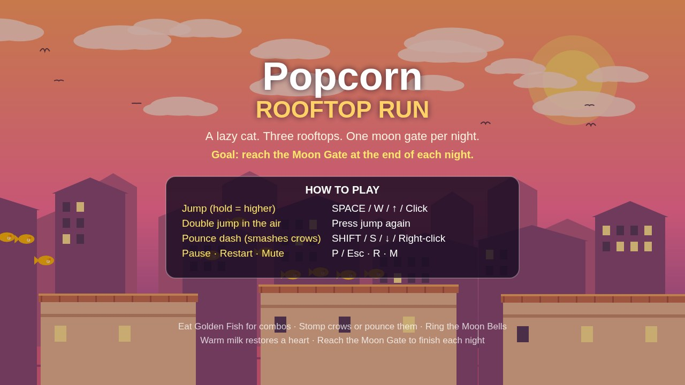
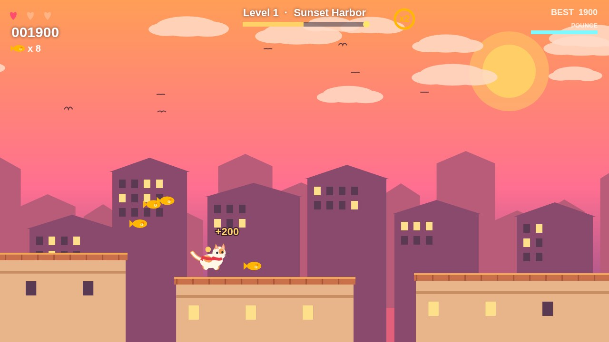
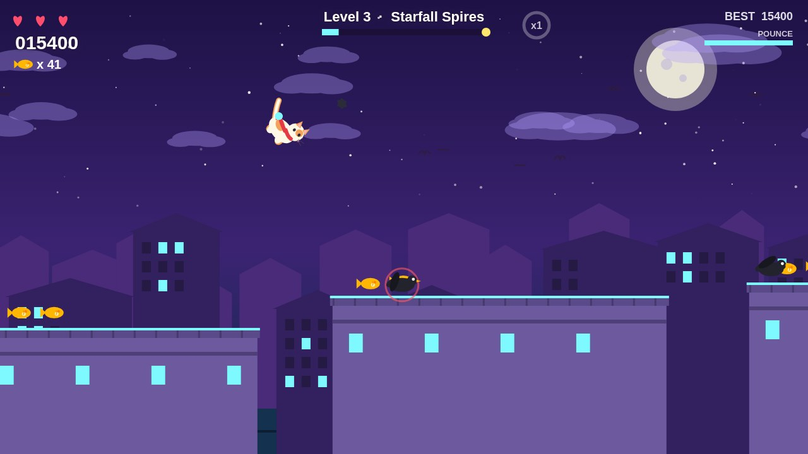
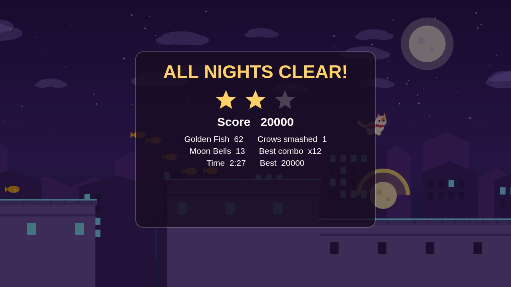

# Popcorn: Rooftop Run

[](https://make.fun/bounty/best-game-01)
[](https://make.fun/bounty/best-game-01)
[](https://make.fun/bounty/best-game-01)

A lazy cat, three rooftops, one moon gate per night. Popcorn is a cream-white long-haired cat in a red scarf who auto-runs across a small town's rooftops at dusk, through a paper-kite market, and under a starfall sky — eating Golden Fish, smashing crows, and ringing Moon Bells on the way to each night's Moon Gate.

An entry for [Make the best game](https://make.fun/bounty/best-game-01) on make.fun.

## How to play

| Action | Keys |
|---|---|
| Jump (hold = higher) | Space / W / ↑ / Left-click |
| Double jump in the air | Press jump again |
| Pounce dash (smashes crows) | Shift / S / ↓ / Right-click |
| Pause | P / Esc |
| Restart the night | R |
| Mute | M |

## Rules

- Run, jump, and double-jump across the rooftops. Falling between roofs costs a heart and sends Popcorn back to the last safe rooftop.
- **Golden Fish**: eat them in a row to build a combo — every 4 in a row raises the multiplier, up to ×8. Taking a hit or falling resets it.
- **Crows**: touching one costs a heart. Stomp one from above or smash it with a pounce to score.
- **Moon Bells**: hung high above the roofs — only a well-timed double jump reaches them. Worth 500 points each.
- **Milk Bowl**: one per night, restores a heart.
- **Chimneys**: bumping into one costs a heart, but you can stand on top. Pouncing into one turns into a small hop.
- **Awnings** (market night): bounce on the striped stall awnings to reach high fish.
- 3 hearts per run. Finishing a night earns a bonus per heart left, plus a **Purrfect** bonus for taking no damage that night.
- The best score is saved on your machine (localStorage).

## Screenshots









## File structure

```
main.ts                  entrypoint: copies game/ + screenshots/ to /output
                         and writes dossier.json with vendor/makefun-game.ts
vendor/makefun-game.ts   the make.fun library, copied verbatim from the kit
game/
  index.html             the game page (canvas + module script)
  src/
    config.js            tuning, level data, palettes, scoring, text
    random.js            seeded PRNG (mulberry32)
    world.js             simulation, collision, scoring, state machine,
                         autopilot AI and the headless self-test
    render.js            all canvas drawing: town, cat, HUD, screens
    fx.js                particles, floating score text, screen shake
    audio.js             Web Audio synthesis: music and sound effects
    input.js             keyboard and pointer input
    shots.js             staged screenshot scenes (autopilot + fixed seed)
    main.js              browser main loop (fixed 60 Hz steps)
serve.ts                 local static server: node serve.ts -> :8080
shots.json               the four screenshot scenes and their URLs
screenshots/             the four entry screenshots, 1280x720
```

Every picture is drawn in code on canvas and every sound is synthesized with Web Audio. No external libraries, images, fonts, or audio files, and the game makes no network requests.

## Running it

```sh
node serve.ts
# open http://localhost:8080/index.html
```

Or open `game/index.html` directly in a browser (use a local server for the ES modules; `node serve.ts` is the easiest).

To hand the entry in, run `node main.ts` (or `MAKEFUN_OUTPUT_DIR=out node main.ts` outside the grader) — it writes `out/dossier.json` next to `out/game/` and `out/screenshots/`.

## License

MIT — see [LICENSE](LICENSE).
